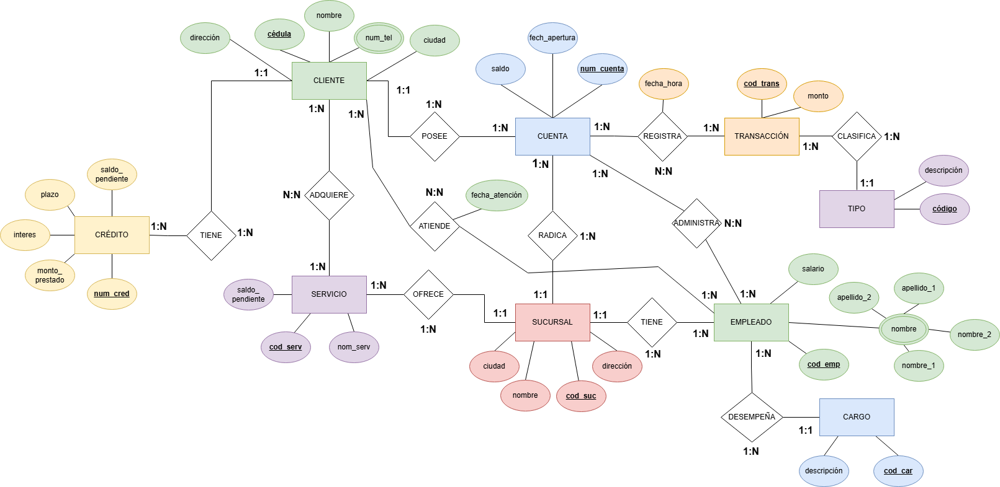
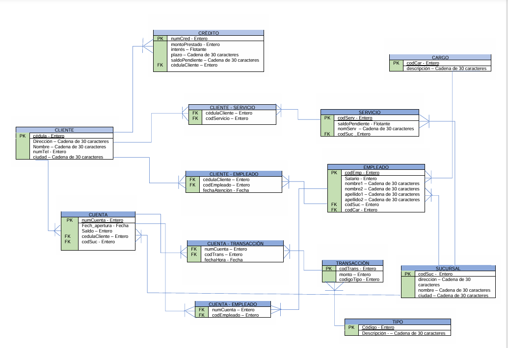
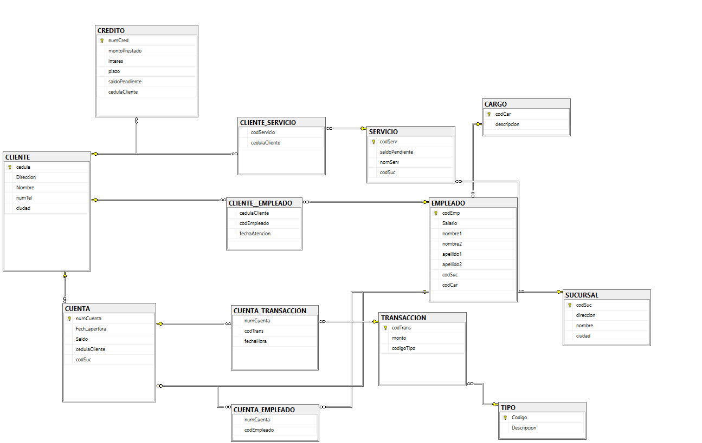

# Base de datos relacional para operaciones bancarias

<p>
  
  
  
</p>

Diseño de una base de datos relacional para gestionar las operaciones internas de una red de oficinas bancarias: clientes, cuentas, créditos, transacciones, sucursales, empleados y servicios adicionales. Va del modelo Entidad-Relación al esquema relacional, se implementa en SQL Server y se valida con consultas en álgebra y cálculo relacional.

Proyecto del curso **Bases de Datos I** (3007847), Universidad Nacional de Colombia, semestre 2026-1.

> **Aviso.** Es un trabajo académico que usa a Bancolombia como caso de estudio, a partir de información pública. **No está afiliado, patrocinado ni avalado por Bancolombia**, y no usa datos reales del banco: todos los registros (cédulas, nombres, saldos) son ficticios y se crearon para probar el diseño.

---

## Integrantes

- Jerónimo Restrepo Ramírez ([@jerofax](https://github.com/jerofax))
- Cristian Camilo Florez Henao
- Jornell Brandt Jiménez
- Yonnattanth Fernando Pedraza Obando

Profesor: Nelson David Zapata Osorio.

## Estado

> **Terminado.** El informe incluido es el de la entrega 1 (diseño conceptual, diseño lógico y consultas formales). La implementación en SQL Server está documentada con el diagrama físico y capturas de resultados.

## El escenario

Se informatiza la gestión interna de una red de oficinas bancarias, con estas reglas:

- Una **sucursal** tiene varias **cuentas** radicadas y varios **empleados**.
- Un **cliente** puede tener varias cuentas y varios **créditos**. Cada cuenta y cada crédito pertenecen a un solo cliente.
- Cada empleado trabaja en una sola sucursal y desempeña un **cargo** (cajero, asesor, gerente…).
- Cada cuenta registra **transacciones**, y cada transacción es de un **tipo** (consignación, retiro, transferencia…).
- Los clientes pueden adquirir **servicios adicionales** (seguro de vida, alertas, asistencia en viajes): relación muchos a muchos.
- Se registra la **atención** de empleados a clientes con su fecha: también muchos a muchos.

El alcance se limita a esas entidades: no se modelan inversiones, seguros como producto financiero ni fiducia.

## Diseño

### Conceptual (Modelo Entidad-Relación)



La fuente editable está en [`diagramas/conceptual.drawio`](diagramas/conceptual.drawio); se abre en [diagrams.net](https://app.diagrams.net).

### Lógico (esquema relacional)



Tablas: `CLIENTE`, `CUENTA`, `CREDITO`, `TRANSACCION`, `TIPO`, `SUCURSAL`, `EMPLEADO`, `CARGO` y `SERVICIO`, más las tablas intermedias que resuelven las relaciones muchos a muchos: `CLIENTE_SERVICIO`, `CLIENTE_EMPLEADO`, `CUENTA_TRANSACCION` y `CUENTA_EMPLEADO`.

### Físico (SQL Server)



## Consultas

El informe formula 12 consultas en **álgebra relacional** y **cálculo relacional**:

| # | Consulta | Operación principal |
|---|---|---|
| 1 | Clientes de Medellín | Selección σ |
| 2 | Nombre y ciudad de los clientes | Proyección π |
| 3 | Clientes de Medellín o Bogotá | Unión ∪ |
| 4 | Clientes con cuenta pero sin crédito | Diferencia − |
| 5 | Clientes con cuenta y crédito | Intersección ∩ |
| 6 | Producto entre clientes y sucursales | Producto cartesiano × |
| 7 | Clientes con créditos registrados | Reunión natural ⋈ |
| 8 | Empleados y su sucursal | Reunión natural ⋈ |
| 9 | Empleados de sucursales en Medellín | Reunión con condición + selección |
| 10 | Clientes con cuenta y crédito | Intersección ∩ |
| 11 | Clientes con cuenta y sin servicios | Diferencia − |
| 12 | Renombrar `CLIENTE` como `USUARIO` | Renombramiento ρ |

Las capturas de [`resultados/`](resultados/) muestran consultas ejecutadas en SQL Server sobre los datos de prueba.

## Estructura del repositorio

```text
bd-operaciones-bancarias/
├── informe/
│   ├── entrega-1.pdf        # informe entregado
│   ├── entrega-1.tex        # fuente LaTeX (clase apa7)
│   └── bibliography.bib
├── diagramas/
│   ├── conceptual.png       # Modelo Entidad-Relación
│   ├── conceptual.drawio    # fuente editable
│   ├── logico.png
│   └── fisico.png
├── sql/
│   └── actualizaciones.sql  # UPDATE de prueba sobre cada tabla
├── resultados/              # capturas de consultas en SQL Server
└── LICENSE
```

## Cómo reproducirlo

1. Instala SQL Server (Express sirve) y SQL Server Management Studio.
2. Crea la base y sus tablas con el script de esquema y datos. [COMPLETAR: agregar `sql/esquema-y-datos.sql`, exportado desde SSMS con *Tareas → Generar scripts → Esquema y datos*]
3. Ejecuta [`sql/actualizaciones.sql`](sql/actualizaciones.sql) para probar las actualizaciones sobre cada tabla.

Para compilar el informe hace falta una distribución de LaTeX con la clase `apa7` y `biber`. Se compila desde la carpeta `informe/`.

## Referencias

- Elmasri, R. y Navathe, S. B. (2016). *Fundamentals of Database Systems* (7.ª ed.). Pearson.
- Silberschatz, A., Korth, H. F. y Sudarshan, S. (2020). *Database System Concepts* (7.ª ed.). McGraw-Hill Education.
- Fuentes públicas de Bancolombia usadas para describir el caso de estudio: ver [`informe/bibliography.bib`](informe/bibliography.bib).

## Licencia

[MIT](LICENSE), a nombre de los cuatro integrantes.
